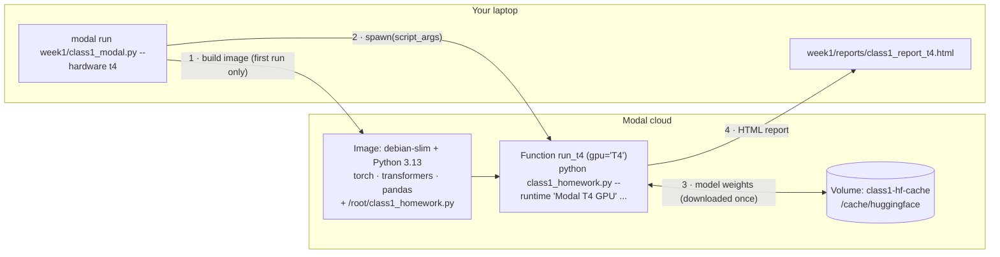

# Running `class1_homework.py` on Modal

This guide runs the Class 1 *Prefill vs Decode* lab ([`class1_homework.py`](class1_homework.py)) on **[Modal](https://modal.com)** cloud hardware instead of Colab: CPU, T4, L4, and A10 GPUs.

You only write one small wrapper file, `week1/class1_modal.py`. Modal then builds the container image, provisions the GPU, caches the model downloads, streams the logs to your terminal, and gives the HTML report back.

> **Verified with** the Modal client `1.6.2`, `torch 2.14.1`, `transformers 5.20.2`, and `pandas 3.1.0`, against Modal's docs as of October 2026. The wrapper below was checked offline (imports, argument handling, CLI wiring) but has not been run on Modal from this machine. Do the GPU sanity check in [Step 6](#step-6-sanity-check-the-gpu-environment-30-seconds) first.

---

## Contents

1. [How it works](#how-it-works)
2. [Step 1: Create a Modal account](#step-1-create-a-modal-account)
3. [Step 2: Install the Modal client locally](#step-2-install-the-modal-client-locally)
4. [Step 3: Authenticate](#step-3-authenticate)
5. [Step 4 (optional): Add a Hugging Face token](#step-4-optional-add-a-hugging-face-token)
6. [Step 5: Create the Modal wrapper](#step-5-create-the-modal-wrapper-week1class1_modalpy)
7. [Step 6: Sanity-check the GPU environment](#step-6-sanity-check-the-gpu-environment-30-seconds)
8. [Step 7: Run the lab on a T4 GPU](#step-7-run-the-lab-on-a-t4-gpu)
9. [Step 8: Run on other hardware, or all at once](#step-8-run-on-other-hardware-or-all-at-once)
10. [Step 9: Collect your results](#step-9-collect-your-results)
11. [Step 10: Write your reflection](#step-10-write-your-reflection)
12. [Step 11: Clean up](#step-11-clean-up)
13. [Cost estimate](#cost-estimate)
14. [What about TPU?](#what-about-tpu)
15. [Troubleshooting](#troubleshooting)
16. [Command cheat sheet](#command-cheat-sheet)

---

## How it works



| Modal concept | What it does in this lab |
|---|---|
| **App** (`modal.App`) | Groups the functions. `modal run` creates a temporary App that stops when your command finishes. |
| **Image** (`modal.Image`) | The container's filesystem: Python, pinned libraries, and `class1_homework.py`. It is built once and then cached. |
| **Function** (`@app.function`) | A remote function with its own hardware: `gpu="T4"`, `cpu=4`, and so on. There is one function per hardware type. |
| **Volume** (`modal.Volume`) | Persistent storage that survives across runs. It holds the Hugging Face cache so TinyLlama (~2.2 GB) is downloaded only once. |
| **Local entrypoint** (`@app.local_entrypoint`) | Runs **on your laptop**. It parses your flags, starts the remote functions, and saves the reports locally. |

You do **not** need `torch` or `transformers` on your laptop, only the `modal` package. All model code runs in the cloud.

---

## Step 1: Create a Modal account

1. Go to **<https://modal.com>** and sign up with GitHub or Google.
2. New workspaces start on the **Starter plan**, which includes **$30/month in free compute credits**. That is far more than this lab needs (see [Cost estimate](#cost-estimate)).
3. **Add a payment method** under *Settings → Usage & Billing*. Modal requires one before you can use a GPU, even if you stay within the free credits.

---

## Step 2: Install the Modal client locally

You need **Python 3.10 or newer** on your laptop. From the repo root:

```bash
cd ~/git-repos/personsal/ai-inference-engineering

python3 -m venv .venv-modal
source .venv-modal/bin/activate        # Windows: .venv-modal\Scripts\activate
pip install --upgrade modal

modal --version                        # e.g. "modal client version: 1.6.2"
```

---

## Step 3: Authenticate

```bash
modal setup
```

This opens a browser window. Approve the login, and the CLI saves a token to `~/.modal.toml`.

> On a headless machine, or if the browser doesn't open, run `modal token new` and follow the printed link.

Check that it worked:

```bash
modal profile current     # prints your workspace name
modal app list            # should print an (empty) table, not an auth error
```

---

## Step 4 (optional): Add a Hugging Face token

TinyLlama and GPT-2 are **public**, so no token is required. Without one you may occasionally hit Hugging Face rate limits (HTTP 429). To avoid that:

1. Create a read-only token at <https://huggingface.co/settings/tokens>.
2. Store it in Modal as a **Secret**:
   ```bash
   modal secret create huggingface-secret HF_TOKEN=hf_xxxxxxxxxxxxxxxxx
   ```
3. In the wrapper from Step 5, add the secret to `COMMON`:
   ```python
   COMMON = dict(
       image=image,
       volumes={"/cache": hf_cache},
       timeout=30 * 60,
       secrets=[modal.Secret.from_name("huggingface-secret")],
   )
   ```
   `transformers` reads `HF_TOKEN` from the environment automatically.

Skip this step unless you see rate-limit errors.

---

## Step 5: Create the Modal wrapper (`week1/class1_modal.py`)

Create **`week1/class1_modal.py`**, next to `class1_homework.py`, with this content:

```python
"""Run class1_homework.py on Modal (CPU, T4, L4, A10 GPUs).

Usage (from the repo root):
    modal run week1/class1_modal.py::check_gpu                 # quick environment check on a T4
    modal run week1/class1_modal.py                            # full lab on a T4 GPU
    modal run week1/class1_modal.py --hardware cpu             # full lab on CPU
    modal run week1/class1_modal.py --hardware all             # cpu + t4 + l4 + a10 in parallel
    modal run week1/class1_modal.py --hardware t4 --profile --kv-steps 5   # extra flags go to the script
"""

import argparse
import subprocess
import sys
from pathlib import Path

import modal

HERE = Path(__file__).parent
SCRIPT_REMOTE_PATH = "/root/class1_homework.py"
REPORT_REMOTE_PATH = "/tmp/class1_report.html"

app = modal.App("class1-prefill-decode")

# Container image: Python + pinned libraries + the homework script.
image = (
    modal.Image.debian_slim(python_version="3.13")
    .uv_pip_install(
        "torch==2.14.1",
        "transformers==5.20.2",
        "pandas==3.1.0",
    )
    .env({"HF_HOME": "/cache/huggingface", "PYTHONUNBUFFERED": "1"})
    .add_local_file(HERE / "class1_homework.py", SCRIPT_REMOTE_PATH)
)

# Persistent volume so TinyLlama (~2.2 GB) and GPT-2 are downloaded only once.
hf_cache = modal.Volume.from_name("class1-hf-cache", create_if_missing=True)

COMMON = dict(image=image, volumes={"/cache": hf_cache}, timeout=30 * 60)


def _run_script(runtime_label: str, script_args: list[str]) -> str:
    """Run the homework script inside the container and return the HTML report."""
    cmd = [
        sys.executable, SCRIPT_REMOTE_PATH,
        "--runtime", runtime_label,
        "--no-reflection",                 # no keyboard in a Modal container
        "--report", REPORT_REMOTE_PATH,
        *script_args,
    ]
    print("$", " ".join(cmd), flush=True)
    subprocess.run(cmd, check=True)
    hf_cache.commit()
    return Path(REPORT_REMOTE_PATH).read_text(encoding="utf-8")


@app.function(cpu=4, memory=16384, **COMMON)
def run_cpu(script_args: list[str]) -> str:
    return _run_script("Modal CPU (4 cores)", script_args)


@app.function(gpu="T4", **COMMON)
def run_t4(script_args: list[str]) -> str:
    return _run_script("Modal T4 GPU", script_args)


@app.function(gpu="L4", **COMMON)
def run_l4(script_args: list[str]) -> str:
    return _run_script("Modal L4 GPU", script_args)


@app.function(gpu="A10", **COMMON)
def run_a10(script_args: list[str]) -> str:
    return _run_script("Modal A10 GPU", script_args)


RUNNERS = {"cpu": run_cpu, "t4": run_t4, "l4": run_l4, "a10": run_a10}


@app.function(gpu="T4", image=image)
def check_gpu():
    """Print the GPU, driver, and library versions the lab will run with."""
    import torch
    import transformers

    subprocess.run(["nvidia-smi"], check=False)
    print("torch", torch.__version__, "| built for CUDA", torch.version.cuda)
    print("transformers", transformers.__version__)
    print("cuda available:", torch.cuda.is_available())
    if torch.cuda.is_available():
        print("device:", torch.cuda.get_device_name(0), "| compute capability:", torch.cuda.get_device_capability(0))
        print("compiled for:", torch.cuda.get_arch_list())


def _parse_args(arglist: tuple[str, ...]) -> tuple[list[str], list[str]]:
    """Split `--hardware` (ours) from everything else (forwarded to the script)."""
    parser = argparse.ArgumentParser(prog="modal run week1/class1_modal.py")
    parser.add_argument("--hardware", default="t4", choices=[*RUNNERS, "all"])
    args, script_args = parser.parse_known_args(list(arglist))
    targets = list(RUNNERS) if args.hardware == "all" else [args.hardware]
    return targets, script_args


@app.local_entrypoint()
def main(*arglist: str):
    targets, script_args = _parse_args(arglist)
    print(f"Hardware: {', '.join(targets)} | script args: {script_args or '(defaults)'}")

    # spawn() starts every target in parallel; get() waits for each result.
    calls = {hw: RUNNERS[hw].spawn(script_args) for hw in targets}

    out_dir = HERE / "reports"
    out_dir.mkdir(exist_ok=True)
    for hw, call in calls.items():
        try:
            html = call.get()
        except Exception as exc:
            print(f"[{hw}] FAILED: {exc}")
            continue
        path = out_dir / f"class1_report_{hw}.html"
        path.write_text(html, encoding="utf-8")
        print(f"[{hw}] report saved → {path}")
```

### What each part does

| Part | Explanation |
|---|---|
| `modal.Image.debian_slim(python_version="3.13")` | A minimal Debian base image with Python 3.13. |
| `.uv_pip_install(...)` | Installs pinned libraries with `uv`, Modal's recommended installer. These versions are known to run the script. The Linux `torch` wheel includes its own CUDA runtime, and Modal's GPU hosts supply the driver. `accelerate` is left out because the script never uses it. |
| `.env({"HF_HOME": ..., "PYTHONUNBUFFERED": "1"})` | `HF_HOME` points the Hugging Face cache at the Volume. `PYTHONUNBUFFERED` makes logs stream line by line instead of arriving in chunks. |
| `.add_local_file(HERE / "class1_homework.py", ...)` | Copies your local script into the container at `/root/class1_homework.py` when the container starts. It is resolved relative to the wrapper file, so you can run `modal run` from any directory. Edits to the script take effect on the next run **without rebuilding the image**. |
| `modal.Volume.from_name(..., create_if_missing=True)` | Creates the persistent cache volume on the first run and reuses it afterwards. |
| `COMMON = dict(...)` | Settings shared by every hardware function: image, volume mount at `/cache`, and a 30-minute timeout. |
| `_run_script` | Runs the **unchanged** homework script as a subprocess, adding `--runtime`, `--no-reflection` (a container has no keyboard), and `--report`. It then returns the report HTML to your laptop. |
| `run_cpu` / `run_t4` / `run_l4` / `run_a10` | Identical functions with different hardware. Modal attaches hardware when the function is defined, so each type needs its own function. `cpu=4, memory=16384` gives the CPU run 4 physical cores and 16 GiB RAM. TinyLlama needs ~4.4 GB in fp32 on CPU. |
| `check_gpu` | A cheap check of the GPU, driver, and torch build. Run it before the full lab. |
| `main(*arglist)` | With `*arglist`, Modal passes your CLI flags through unparsed. `--hardware` is handled here and **everything else goes to `class1_homework.py`**. `.spawn()` starts all targets in parallel and `.get()` collects each report. |

> **Python note:** `modal run` imports this file **both** on your laptop and inside the container. The `import torch` sits inside `check_gpu` so that your laptop never needs torch installed.

Your `week1/` folder should now contain:

```
week1/
├── class1.py
├── class1_homework.py      ← the script (runs in the container)
├── class1_modal.py         ← the Modal wrapper (new)
└── ...
```

---

## Step 6: Sanity-check the GPU environment (~30 seconds)

From the repo root:

```bash
modal run week1/class1_modal.py::check_gpu
```

The `::check_gpu` suffix runs just that function and bypasses `main`.

**The first time**, Modal builds the image (installing torch and its CUDA libraries, a few GB), which takes a few minutes. Later runs reuse the cached image and start in seconds.

Expected output (exact versions may differ):

```
+-----------------------------------------------------------------------------------------+
| NVIDIA-SMI ...           Driver Version: ...           CUDA Version: ...                 |
|   0  Tesla T4                       ...   15360MiB                                       |
+-----------------------------------------------------------------------------------------+
torch 2.14.1 | built for CUDA 1x.x
transformers 5.20.2
cuda available: True
device: Tesla T4 | compute capability: (7, 5)
compiled for: [..., 'sm_75', ...]
```

What to check:
- `cuda available: True`
- `compiled for:` includes **`sm_75`**, the T4's architecture. If it's missing, see [Troubleshooting](#troubleshooting).

---

## Step 7: Run the lab on a T4 GPU

```bash
mkdir -p week1/reports
modal run week1/class1_modal.py 2>&1 | tee week1/reports/t4.log
```

`--hardware` defaults to `t4`. The `tee` saves a copy of the full log next to the report.

What happens:

1. **Image**: reused from Step 6, so this is instant.
2. **Container start**: Modal provisions a T4 and mounts the `class1-hf-cache` volume.
3. **Model download**, first run only: TinyLlama and GPT-2 are downloaded into the volume.
4. **The lab runs**, and the familiar output streams to your terminal: `PREFILL [1/6] ...`, `DECODE step ...`, the `RESULTS` block, the cost analysis, and the KV cache comparison.
5. **The report comes back** and is saved locally:
   ```
   [t4] report saved → .../week1/reports/class1_report_t4.html
   ```
6. **The App stops** automatically, and billing stops with it.

Open the report:

```bash
open week1/reports/class1_report_t4.html        # macOS  (Linux: xdg-open)
```

---

## Step 8: Run on other hardware, or all at once

### Pick the hardware

```bash
modal run week1/class1_modal.py --hardware cpu   2>&1 | tee week1/reports/cpu.log
modal run week1/class1_modal.py --hardware l4    2>&1 | tee week1/reports/l4.log
modal run week1/class1_modal.py --hardware a10   2>&1 | tee week1/reports/a10.log
```

### Run every hardware type in parallel

```bash
modal run week1/class1_modal.py --hardware all 2>&1 | tee week1/reports/all.log
```

This starts CPU, T4, L4, and A10 at the same time and saves four reports: `class1_report_{cpu,t4,l4,a10}.html`. Logs from all containers interleave in the terminal.

> **Tip:** do one single-hardware run (Step 7) **before** `--hardware all`. That warms the model cache, so four containers don't download the same 2.2 GB into the same volume at once.

### Pass flags through to `class1_homework.py`

Any flag other than `--hardware` is forwarded to the script:

```bash
# torch.profiler on the long prompt (prefill vs decode operator tables)
modal run week1/class1_modal.py --hardware t4 --profile

# shorter generation, longer KV comparison, cheaper cost proxy
modal run week1/class1_modal.py --hardware t4 --max-new-tokens 20 --kv-steps 20 --pricing-model gpt-4o-mini

# skip the KV cache experiment
modal run week1/class1_modal.py --hardware cpu --skip-kv-compare

# override the runtime label shown in the report
modal run week1/class1_modal.py --hardware t4 --runtime "Modal T4 (run 2)"
```

These are all the script's options (`python week1/class1_homework.py --help`):

| Flag | Default | Meaning |
|---|---|---|
| `--max-new-tokens N` | 50 | Tokens generated per run (1 from prefill, N−1 from decode) |
| `--profile` | off | Profile matmul and attention ops on the long prompt |
| `--pricing-model {gpt-4o,gpt-4o-mini}` | gpt-4o | Price list used for the cost analysis |
| `--requests-per-day`, `--avg-input-tokens`, `--avg-output-tokens` | 10,000 / 500 / 200 | Inputs to the scale cost calculator |
| `--skip-kv-compare` | off | Skip the with/without KV cache experiment |
| `--kv-steps N` | 10 | Decode steps in the KV cache experiment |
| `--runtime LABEL` | set by the wrapper | Label shown in tables and reports |

`--report` and `--no-reflection` are set by the wrapper. Leave them alone.

---

## Step 9: Collect your results

| What | Where |
|---|---|
| HTML reports (timings, costs, pivot tables) | `week1/reports/class1_report_<hardware>.html` |
| Full console logs (including the KV cache table, which isn't in the HTML) | `week1/reports/<hardware>.log` (from `tee`) |
| Logs in the browser | <https://modal.com/apps>, then click the `class1-prefill-decode` run |
| Cached model files | `modal volume ls class1-hf-cache /huggingface` |

Pull just the summary lines out of the logs to compare hardware:

```bash
grep -h -A5 "RESULTS — runtime" week1/reports/*.log
grep -h "Memory takeaway" week1/reports/*.log
```

> Consider adding `week1/reports/` to `.gitignore` if you don't want generated reports committed.

---

## Step 10: Write your reflection

The container has no keyboard, so the reflection section in each Modal report says *"(non-interactive — skipping prompts)"*. Answer the three questions in your homework write-up, using the numbers from your reports:

1. **Runtime(s) you tested.** For example: Modal CPU (4 cores), T4, L4, A10.
2. **TinyLlama vs GPT-2:** what differed in prefill and decode timing?
3. **What surprised you about prefill vs decode?**

Things worth comparing across hardware:
- **Prefill, short vs long prompt.** On CPU, the long prompt is clearly slower. On a GPU, the two are often almost the same, because the GPU is underused at these sizes.
- **Decode tok/s.** Compare the T4 against the L4 and A10 (more memory bandwidth and compute). Decode at batch size 1 is limited by memory bandwidth.
- **KV cache speedup on CPU vs GPU.** It is usually much larger on CPU for a short prompt.

To put the reflection into a report, edit the `<pre>` block under **Reflection** in the HTML file, or run the script locally without `--no-reflection`.

---

## Step 11: Clean up

`modal run` Apps are **temporary** and stop as soon as the command finishes, so nothing keeps billing.

```bash
modal app list                          # confirm nothing is still running
modal volume delete class1-hf-cache     # optional: delete the cached models (~3 GB)
```

Keep the volume if you plan to re-run the lab; it saves the download time. Volume storage is cheap but not free, so check Modal's pricing page.

If you ever start a run with `--detach` and want to stop it early:

```bash
modal app stop class1-prefill-decode
```

---

## Cost estimate

From Modal's pricing page (October 2026); check <https://modal.com/pricing> for current numbers:

| Resource | Price | ≈ per hour |
|---|---|---|
| T4 GPU | $0.000164 / s | $0.59 |
| L4 GPU | $0.000222 / s | $0.80 |
| A10 GPU | $0.000306 / s | $1.10 |
| CPU | $0.0000131 / physical core / s | $0.047 / core |
| Memory | $0.00000222 / GiB / s | $0.008 / GiB |

A full lab run takes a few minutes of container time: model load plus 4 timed runs plus the KV comparison.

| Run | Rough cost |
|---|---|
| `check_gpu` | < $0.01 |
| One T4 run (~5 min) | ~$0.05 |
| CPU run, 4 cores and 16 GiB (~10 min) | ~$0.05 |
| `--hardware all` | well under $0.50 |

That is a small fraction of the **$30/month** Starter credits. You pay only while containers are running, and GPU containers also bill a little for CPU and memory.

---

## What about TPU?

The original lab compares **CPU vs TPU vs T4 GPU**. **Modal offers only NVIDIA GPUs and CPUs, no TPUs.** For the TPU part:

- open the original notebook in **Colab** (*Runtime → Change runtime type → TPU*), or
- run `python class1_homework.py --runtime "Colab TPU" --no-reflection` in a Colab TPU runtime.

Then compare that TPU report with your Modal CPU and GPU reports.

---

## Troubleshooting

| Symptom | Cause | Fix |
|---|---|---|
| `Token missing. Could not authenticate client` | Not logged in | `modal setup` (or `modal token new`) |
| GPU function won't start or asks for billing | No payment method on file | Add one under *Settings → Usage & Billing* |
| `Unknown GPU type 'A10G'` | Older tutorials use `A10G`; Modal now calls it `A10` | Use `gpu="A10"` |
| `FileNotFoundError: ... class1_homework.py` during `modal run` | The wrapper isn't next to the script, or the script was renamed | Keep both files in `week1/` |
| `no kernel image is available for execution on the device` | This torch build has no T4 (`sm_75`) kernels | Check `compiled for:` in Step 6. Pin a torch version whose arch list includes `sm_75`. |
| `CUDA driver version is insufficient for CUDA runtime version` | torch was built for a newer CUDA than the host driver | Pin an older `torch==...` in `uv_pip_install` (Step 6 prints the driver's CUDA version) |
| `subprocess.CalledProcessError: ... returned non-zero exit status 1` | The script finished with **no valid results** | Scroll up in the log for `ERROR:` lines from `prefill_and_decode` |
| `FunctionTimeoutError` | Run took longer than 30 minutes (e.g. CPU with a large `--kv-steps`) | Raise `timeout=` in `COMMON` |
| CPU run killed / out of memory | TinyLlama fp32 needs ~4.4 GB plus overhead | Raise `memory=` in `run_cpu` |
| `429 Too Many Requests` from huggingface.co | Anonymous rate limit | Add the HF token secret (Step 4) |
| `uv_pip_install` fails to resolve | Package or index issue | Replace `.uv_pip_install(` with `.pip_install(` |
| Need to poke around inside the container | n/a | `modal shell week1/class1_modal.py::run_t4` opens a shell with the same image, GPU, and volume |
| Your laptop closed mid-run | `modal run` stops the App when the client disconnects | Re-run. Use `modal run --detach ...` to keep containers running, but the report is only saved locally if the client stays connected. |

---

## Command cheat sheet

```bash
# one-time setup
python3 -m venv .venv-modal && source .venv-modal/bin/activate
pip install --upgrade modal
modal setup

# check the environment
modal run week1/class1_modal.py::check_gpu

# run the lab
mkdir -p week1/reports
modal run week1/class1_modal.py                          # T4 (default)
modal run week1/class1_modal.py --hardware cpu           # CPU
modal run week1/class1_modal.py --hardware all           # CPU + T4 + L4 + A10
modal run week1/class1_modal.py --hardware t4 --profile  # + torch.profiler

# inspect / clean up
modal app list
modal volume ls class1-hf-cache /huggingface
modal volume delete class1-hf-cache
```
