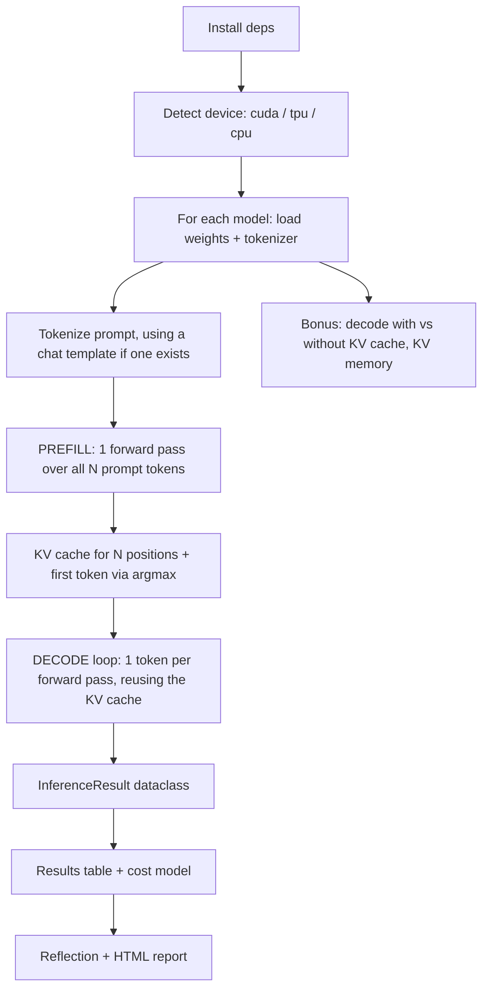

# `class1.py`: A Detailed Walkthrough

> **Source:** [`week1/class1.py`](class1.py), a Google Colab notebook exported as a `.py` file.
> **Topic:** *Prefill vs Decode*. The script times the two phases of LLM inference on **CPU**, **TPU**, and **T4 GPU**, using **TinyLlama-1.1B** and **GPT-2**.

---

## Table of Contents

1. [The Big Picture](#1-the-big-picture)
2. [Before You Run It: This Is a Notebook, Not a Script](#2-before-you-run-it-this-is-a-notebook-not-a-script)
3. [Core Concepts Primer](#3-core-concepts-primer)
4. [Section-by-Section Code Walkthrough](#4-section-by-section-code-walkthrough)
   - [4.0 Header and install](#40-header-and-install-lines-118)
   - [4.1 Imports and device detection](#41-imports-and-device-detection-lines-2080)
   - [4.2 Timing helpers](#42-timing-helpers-lines-82109)
   - [4.3 Configuration, prompts, tokenization, model loading](#43-configuration-prompts-tokenization-model-loading-lines-111176)
   - [4.4 Result container and small helpers](#44-result-container-and-small-helpers-lines-178231)
   - [4.5 `prefill_and_decode`, the core of the lab](#45-prefill_and_decode-the-core-of-the-lab-lines-234387)
   - [4.6 Profiler: attention and matmul focus](#46-profiler-attention-and-matmul-focus-lines-389417)
   - [4.7 Running the experiments](#47-running-the-experiments-lines-419508)
   - [4.8 Results table](#48-results-table-lines-510538)
   - [4.9 Cost model: input vs output tokens](#49-cost-model-input-vs-output-tokens-lines-540662)
   - [4.10 Reflection](#410-reflection-lines-664684)
   - [4.11 HTML report export](#411-html-report-export-lines-686794)
   - [4.12 With vs without KV cache, plus memory](#412-with-vs-without-kv-cache-plus-memory-lines-796979)
5. [The Two Models, Side by Side](#5-the-two-models-side-by-side)
6. [What You Should Expect to See on Each Device](#6-what-you-should-expect-to-see-on-each-device)
7. [Benchmarking Caveats and Known Issues](#7-benchmarking-caveats-and-known-issues)
8. [Suggested Improvements](#8-suggested-improvements)
9. [Glossary](#9-glossary)

---

## 1. The Big Picture

The script is a lab exercise. It runs **the same inference code** on whatever hardware the Colab runtime has, and it **times the prefill and decode phases separately**. To do that it skips Hugging Face's `model.generate()`, which hides both phases inside one call, and writes the generation loop by hand.

End to end, the script:

1. **Detects hardware** in priority order: GPU, then TPU, then CPU.
2. **Loads two models**: TinyLlama-1.1B-Chat (a Llama-architecture chat model) and GPT-2 small (124M, a classic baseline).
3. **Runs greedy generation by hand**: one prefill forward pass over the prompt, then a decode loop that produces one token per forward pass using the KV cache.
4. **Records metrics** for each run: prefill time, decode time, TTFT, and decode tokens/sec.
5. **Optionally profiles** matmul and attention operators in each phase.
6. **Converts token counts into dollar costs** using OpenAI list prices as a stand-in, to show why output tokens are the expensive ones.
7. **Collects a written reflection** and **exports an HTML report**.
8. **Bonus experiment:** compares decoding **with vs without the KV cache** and measures **KV cache memory per token**, which shows the effect of MHA vs GQA.



---

## 2. Before You Run It: This Is a Notebook, Not a Script

The file came from **"File → Download → .py" in Colab**, so it still contains notebook-only constructs. `python week1/class1.py` will **not** work as is.

| Construct | Where | Why it breaks plain Python |
|---|---|---|
| `!pip install -q ...` | [L18](class1.py#L18) | IPython shell escape. Plain Python raises a `SyntaxError`. |
| `display(df)` | [L538](class1.py#L538), [L628](class1.py#L628), [L645](class1.py#L645), [L970](class1.py#L970) | `display` is an IPython/Jupyter built-in, so plain Python raises a `NameError`. |
| `input(...)` | [L433](class1.py#L433), [L670–672](class1.py#L670), [L949](class1.py#L949) | Blocks waiting for keyboard input. Fine in a notebook, awkward in automation. |
| `/content/class1_report.html` | [L710](class1.py#L710) | `/content` is Colab's working directory and usually doesn't exist locally. |
| `google.colab.files` | [L700](class1.py#L700) | Only exists in Colab. The import is wrapped in `try/except`, so this one is safe. |

A few other notebook artifacts:

- **The triple-quoted strings between code blocks** (e.g. `"""## 2. Timing helpers ..."""`) were the notebook's **markdown cells**. In Python they are string expressions that do nothing. The first one, at lines 2–16, becomes the module docstring.
- **Repeated imports.** `pandas` is imported three times and `datetime` twice. Each notebook cell was meant to run on its own, so each one imports what it needs.

**How to run it:** open it in Colab (the original notebook link is in the docstring at [L7](class1.py#L7)), or paste it into Jupyter cell by cell. Switch runtimes with **Runtime → Change runtime type** to compare CPU, T4 GPU, and TPU.

---

## 3. Core Concepts Primer

You need these ideas to read the code.

### 3.1 Autoregressive generation

A causal language model predicts **one next token at a time**. Each new token is appended to the input and the model runs again. Generating *T* tokens from an *N*-token prompt therefore takes **1 prefill pass plus T−1 decode passes**.

```
prompt (N tokens) ──► [ PREFILL: 1 forward over N tokens ] ──► logits[-1] → token₁
                                   │ writes K,V for positions 0..N-1
                                   ▼
                              KV cache (N)
token₁ ──► [ DECODE step 1: forward over 1 token, reads KV(N)   ] ──► token₂ , KV(N+1)
token₂ ──► [ DECODE step 2: forward over 1 token, reads KV(N+1) ] ──► token₃ , KV(N+2)
  ...
token_{T-1} ──► [ DECODE step T-1 ] ──► token_T
```

### 3.2 Prefill

- **What:** one forward pass over **all prompt tokens at once**.
- **Math:** every linear layer multiplies a `[N × d]` activation matrix by a `[d × d']` weight matrix. That is a matrix-matrix multiply (**GEMM**).
- **Character:** **compute-bound** once *N* is large enough. Each weight loaded from memory is reused for *N* tokens, so arithmetic intensity is high.
- **Outputs:** logits for every prompt position (only the last one is used) and the **K and V tensors for every layer and every prompt position**. Together those tensors are the KV cache.
- **Serving metric:** prefill latency is most of the **TTFT (Time To First Token)**.

### 3.3 Decode

- **What:** one forward pass per new token, with an input of **one token**.
- **Math:** every linear layer multiplies a `[1 × d]` vector by a `[d × d']` matrix. That is a matrix-vector multiply (**GEMV**).
- **Character:** **memory-bandwidth-bound**. To produce one token the hardware must read **every weight**, plus the KV cache, from memory, and then does only about 2 FLOPs per weight.
- **Serving metric:** **TPOT (Time Per Output Token)**, or its inverse, decode **tokens/sec**. This sets how fast the response streams to the user.

### 3.4 KV cache

Attention for a new token needs the **keys and values of every previous token**. Those don't change once computed (the model is causal), so they can be **cached and reused**:

- **Without a cache**, every step re-runs the whole sequence. Per-step cost grows with sequence length, and total work over a generation grows roughly quadratically.
- **With a cache**, every step processes only the new token, appends its K and V, and attends over the cached ones.

KV cache size per token:

```
bytes_per_token = 2 (K and V) × num_layers × num_kv_heads × head_dim × bytes_per_element
```

This is why **GQA (Grouped-Query Attention)**, where several query heads share one K/V head, shrinks the cache dramatically. Section 4.12 measures this directly.

### 3.5 Metrics the script computes

| Metric | Formula in the code | Meaning |
|---|---|---|
| `prefill_sec` | time of the prefill forward pass plus device sync | Prompt-processing latency |
| `decode_sec` | wall time of the whole decode loop | Time to stream the remaining tokens |
| `first_decode_step_sec` | time of decode step #1 only | Latency of a single decode step |
| `ttft_sec` | `prefill_sec + first_decode_step_sec` | The code's definition of TTFT (see the caveat in §7) |
| `decode_tokens_per_sec` | `(generated_tokens − 1) / decode_sec` | Decode throughput at batch size 1 |

### 3.6 Compute-bound vs memory-bound: a back-of-envelope roofline

**Arithmetic intensity** is FLOPs performed per byte moved from memory. In a linear layer, each weight element contributes about 2 FLOPs (a multiply and an add) **per token processed**.

| Phase | FLOPs per weight byte (fp16) | Regime on a T4 |
|---|---|---|
| Decode (batch 1) | ≈ 2 FLOPs / 2 bytes ≈ **1 FLOP/byte** | Deeply memory-bound |
| Prefill (N tokens) | ≈ **N FLOPs/byte** | Compute-bound only once N passes the "ridge point" |

**NVIDIA T4** (Colab's free GPU): about **65 TFLOPS** peak fp16 on tensor cores and about **320 GB/s** memory bandwidth, with 16 GB of GDDR6. The ridge point is roughly 65e12 / 320e9 ≈ **200 FLOPs/byte**. Peak FLOPS are rarely reached, so the real ridge point is lower.

What this predicts for the lab:

- **Decode ceiling at batch 1** ≈ `memory_bandwidth / model_bytes`:
  - TinyLlama fp16 (~2.2 GB): **≤ ~145 tok/s** on a T4
  - GPT-2 fp16 (~0.25 GB): **≤ ~1,300 tok/s** on a T4
  - A plain PyTorch eager loop lands far below these numbers. Each forward pass launches hundreds of small CUDA kernels, and the Python and launch overhead per step becomes the bottleneck. This hits GPT-2 hardest, because it is so small.
- **Prefill on GPU:** the long prompt is only about 150–170 tokens, which is below the ridge point. The GPU stays underutilized for both prompts, so **short and long prefill times may look surprisingly similar on GPU**.
- **Prefill on CPU:** a few vCPUs deliver relatively little compute, so **prefill time grows roughly linearly with prompt length**, and the long prompt is noticeably slower.

---

## 4. Section-by-Section Code Walkthrough

### 4.0 Header and install (lines 1–18)

```python
# -*- coding: utf-8 -*-
"""class1.ipynb ... # Class 1: Prefill vs Decode ..."""

!pip install -q transformers accelerate nbconvert pandas
```

- `# -*- coding: utf-8 -*-` is a PEP 263 encoding declaration. It is redundant in Python 3, where UTF-8 is the default, but harmless. The file contains non-ASCII characters such as `→` and `—`.
- The docstring holds the lab's title and objective.
- `!pip install -q` installs the packages quietly (`-q`):
  - `transformers`: the model and tokenizer classes (`AutoModelForCausalLM`, `AutoTokenizer`).
  - `accelerate`: installed but **not used directly** in this file. It is often needed for `device_map="auto"` and faster loading.
  - `nbconvert`: meant for PDF export, which isn't implemented here (see §7).
  - `pandas`: the results tables.
- PyTorch isn't installed because Colab ships with it.

---

### 4.1 Imports and device detection (lines 20–80)

```python
import time
from dataclasses import dataclass, field
from typing import Any, Dict, List, Optional, Tuple

import torch
from torch.profiler import ProfilerActivity, profile, record_function
from transformers import AutoModelForCausalLM, AutoTokenizer
```

| Import | Used for |
|---|---|
| `time` | `time.perf_counter()`, a monotonic high-resolution clock for wall-clock timing |
| `dataclass` | `InferenceResult` and `KVCacheCompareResult` |
| `field`, `Any`, `Dict`, `record_function` | **Not used** (leftovers) |
| `List`, `Optional`, `Tuple` | Type hints |
| `torch.profiler.profile`, `ProfilerActivity` | Operator-level profiling (§4.6) |
| `AutoModelForCausalLM` | Builds the right model class (e.g. `LlamaForCausalLM`, `GPT2LMHeadModel`) from the Hub config |
| `AutoTokenizer` | Builds the matching tokenizer |

#### Optional TPU support

```python
try:
    import torch_xla
    import torch_xla.core.xla_model as xm
    TPU_AVAILABLE = True
except ImportError:
    TPU_AVAILABLE = False
```

- **`torch_xla`** is the bridge between PyTorch and Google TPUs. It is only installed on TPU runtimes.
- The `try/except ImportError` pattern is **feature detection**: the module-level flag `TPU_AVAILABLE` records whether TPU support exists, and the same code runs everywhere.
- `xm` (XLA model utilities) supplies `xm.xla_device()` and `xm.mark_step()`.

#### `detect_available_devices()` ([L39](class1.py#L39))

```python
def detect_available_devices() -> List[str]:
    devices = []
    if torch.cuda.is_available():
        devices.append("cuda")
    if TPU_AVAILABLE:
        devices.append("tpu")
    devices.append("cpu")  # always available
    return devices
```

- Returns a **priority-ordered** list. Callers take `[0]`, the "best" device present.
- A Colab runtime has either a GPU or a TPU, never both, so in practice the list is `["cuda", "cpu"]`, `["tpu", "cpu"]`, or `["cpu"]`.

#### `resolve_device(device)` ([L50](class1.py#L50))

Maps a **logical name** (`"cuda"`, `"tpu"`, `"cpu"`) to a **`torch.device` object** and a **human-readable label**.

```python
if device == "cuda":
    ...
    name = torch.cuda.get_device_name(0)        # e.g. "Tesla T4"
    return torch.device("cuda"), f"GPU ({name})"
if device == "tpu":
    ...
    return xm.xla_device(), "TPU"               # torch.device("xla:0")
if device == "cpu":
    return torch.device("cpu"), "CPU"
raise ValueError(...)
```

Details worth noticing:

- **Fail-fast errors with fix-it hints.** The `RuntimeError` messages tell the student exactly which Colab menu to use. This is good practice for lab code.
- **The TPU device type is `"xla"`, not `"tpu"`.** `xm.xla_device()` returns `torch.device("xla:0")`, which is why `sync_device()` later checks `device.type == "xla"`.
- Newer `torch_xla` releases prefer `torch_xla.device()` over `xm.xla_device()`. The old call still works but may print a deprecation warning.

Lines 78–80 print a quick health check showing which backends are available.

---

### 4.2 Timing helpers (lines 82–109)

#### `Timer` ([L89](class1.py#L89))

```python
class Timer:
    def __init__(self, device: torch.device):
        self._start = None
    def start(self) -> None:
        self._start = time.perf_counter()
    def stop(self) -> float:
        if self._start is None:
            return 0.0
        return time.perf_counter() - self._start
```

- A minimal stopwatch around `time.perf_counter()`. That clock is monotonic and high-resolution, which makes it the right choice for benchmarks; `time.time()` can jump when the system clock adjusts.
- **The `device` argument is accepted but ignored.** It is kept so the API could later switch to device-specific timers.
- **Doc/code mismatch:** the markdown cell above it says *"On GPU we use `torch.cuda.Event`"*, but the code always uses wall-clock time. Wall-clock time is still correct here because each timed region ends with `sync_device()`. It does include some host-side overhead that CUDA events would exclude.
- `stop()` returns elapsed seconds and does not reset, so `stop()` can be called more than once.

#### `sync_device(device)` ([L104](class1.py#L104))

```python
def sync_device(device: torch.device) -> None:
    if device.type == "cuda":
        torch.cuda.synchronize()
    elif device.type == "xla":
        xm.mark_step()
```

This function matters more than its size suggests.

- **GPU execution is asynchronous.** When Python calls `model(...)` on CUDA, PyTorch *enqueues* kernels and returns almost immediately. Without `torch.cuda.synchronize()` you would time the **kernel launches**, not the computation.
- **TPU execution in `torch_xla` is lazy.** Operations build a graph. `xm.mark_step()` cuts the graph, compiles it with XLA (or reuses a cached compilation), and **dispatches** it. It does **not necessarily block until the device finishes**; `xm.wait_device_ops()` is the call that waits. In this script the later `.item()` call forces completion, so per-phase TPU timings are approximate (see §7).
- **CPU** is synchronous, so nothing is needed.

> **Serving takeaway (from the notebook):** TTFT is dominated by prefill. Decode throughput (tok/s) determines how fast the rest of the answer streams.

---

### 4.3 Configuration, prompts, tokenization, model loading (lines 111–176)

#### Global configuration

```python
MAX_NEW_TOKENS = 50

MODELS = {
    "TinyLlama-1.1B": "TinyLlama/TinyLlama-1.1B-Chat-v1.0",
    "GPT-2": "gpt2",
}
```

- `MAX_NEW_TOKENS = 50` is the total number of generated tokens: **1 from prefill plus 49 from decode**.
- `MODELS` maps a display label to a **Hugging Face Hub repo ID**. Dicts keep insertion order (Python 3.7+), so TinyLlama always runs first.

#### Prompts

```python
SHORT_PROMPT = "Explain the difference between prefill and decode in LLM inference in one paragraph."
LONG_PROMPT  = SHORT_PROMPT + " " + " ".join([SHORT_PROMPT] * 8)
```

- `SHORT_PROMPT` is **84 characters**.
- `LONG_PROMPT` is the short prompt **repeated 9 times** (1 + 8), separated by spaces, for **764 characters**.
- Approximate token counts, which depend on the tokenizer and chat template:
  - Short: about 15–20 tokens for GPT-2, more for TinyLlama because the chat template adds tokens.
  - Long: about 9× that, roughly 150–170 tokens.
- The repetition is intentional. **Only the prompt length changes** while the content stays the same, which isolates how prefill scales with *N*.

#### Pricing table

```python
OPENAI_PRICING = {
    "gpt-4o":      {"input_per_1m": 2.50, "cached_input_per_1m": 1.25,  "output_per_1m": 10.00},
    "gpt-4o-mini": {"input_per_1m": 0.15, "cached_input_per_1m": 0.075, "output_per_1m": 0.60},
}
DEFAULT_PRICING_MODEL = "gpt-4o"
```

- Prices are USD per **1 million tokens**, hardcoded as **list prices at the time of writing**. Check current pricing before relying on them.
- For both models, **output costs 4× input**. §4.9 explains why.
- `cached_input_per_1m` is **defined but never used**. It is relevant anyway: "cached input" is **prompt (prefix) caching**, where the provider reuses an earlier request's KV cache, skips prefill compute, and charges less. It ties straight back to this lab's KV cache topic.

#### `tokenize_prompt(tokenizer, prompt, device)` ([L146](class1.py#L146))

```python
def tokenize_prompt(tokenizer, prompt: str, device: torch.device) -> dict:
    if getattr(tokenizer, "chat_template", None):
        messages = [{"role": "user", "content": prompt}]
        prompt_text = tokenizer.apply_chat_template(
            messages, add_generation_prompt=True, tokenize=False
        )
        input_ids = tokenizer(prompt_text, return_tensors="pt")["input_ids"]
    else:
        input_ids = tokenizer(prompt, return_tensors="pt")["input_ids"]
    ...
    return {"input_ids": input_ids.to(device)}
```

Step by step:

1. **`getattr(tokenizer, "chat_template", None)`** checks whether the tokenizer ships a **chat template**, a Jinja template that formats a conversation the way the model saw it during fine-tuning.
   - **TinyLlama-Chat** has one (Zephyr style), so its prompt becomes roughly:
     ```
     <|user|>
     Explain the difference between prefill and decode ...</s>
     <|assistant|>
     ```
   - **GPT-2** has none, so the raw prompt is tokenized as plain text.
2. **`add_generation_prompt=True`** appends the assistant header (`<|assistant|>`). The model then starts *answering* instead of continuing the user's message.
3. **`tokenize=False`** returns the formatted **string**, which is then tokenized in a second call. A common pitfall with this two-step approach is a **duplicated BOS token** when the template already includes one. `apply_chat_template(..., tokenize=True, return_tensors="pt")` does it in a single step.
4. **`return_tensors="pt"`** returns PyTorch tensors of shape `[batch=1, seq_len]`. Only `input_ids` is kept and the `attention_mask` is discarded. That is fine for a single unpadded sequence; transformers may print a warning.
5. **Defensive checks:** the `dim() == 1` branch, which adds a batch dimension, never fires with `return_tensors="pt"` but does no harm. An empty tokenization raises a clear error.
6. **`.to(device)`** moves the token IDs to the same device as the model. Mismatched devices are one of the most common PyTorch errors.

#### `load_model_and_tokenizer(model_name, device)` ([L163](class1.py#L163))

```python
tokenizer = AutoTokenizer.from_pretrained(model_name)
dtype = torch.float16 if device.type == "cuda" else torch.float32
try:
    model = AutoModelForCausalLM.from_pretrained(model_name, dtype=dtype)
except TypeError:
    model = AutoModelForCausalLM.from_pretrained(model_name, torch_dtype=dtype)
if tokenizer.pad_token is None:
    tokenizer.pad_token = tokenizer.eos_token
model = model.to(device)
model.eval()
```

| Line | What it does and why |
|---|---|
| `from_pretrained(model_name)` | Downloads the config, weights, and tokenizer files from the HF Hub on the first call and caches them under `~/.cache/huggingface`. |
| `dtype = float16 if cuda else float32` | **fp16 on GPU** halves memory and bandwidth and enables T4 tensor cores. **fp32 on CPU and TPU**, because fp16 is slow or poorly supported on many CPUs. TPUs natively prefer **bfloat16**, so fp32 is a conservative choice there. **Consequence:** cross-device comparisons also compare precisions. |
| `try: dtype=... except TypeError: torch_dtype=...` | A **version-compatibility shim**. Recent `transformers` renamed `torch_dtype` to `dtype`, and the fallback covers older versions. |
| `pad_token = eos_token` | GPT-2 has no pad token. Nothing in this script pads, so this is a defensive habit that would matter for batched generation. |
| `model.to(device)` | Moves all parameters (and buffers) to the target device. The model is first built in host memory, which is fine for 1.1B parameters; very large models use `device_map="auto"` (accelerate) instead. |
| `model.eval()` | Switches off training-only behavior, most importantly **dropout** (GPT-2 uses dropout 0.1). Without it, outputs would be random and wrong. |

---

### 4.4 Result container and small helpers (lines 178–231)

#### `InferenceResult` dataclass ([L180](class1.py#L180))

```python
@dataclass
class InferenceResult:
    device_label: str
    prompt_label: str
    prompt_tokens: int
    generated_tokens: int
    prefill_sec: float
    decode_sec: float
    ttft_sec: float
    decode_tokens_per_sec: float
    first_decode_step_sec: float
    generated_text: str = ""
    error: Optional[str] = None
    model_name: str = ""
    model_repo: str = ""
    recorded_at: str = ""
```

- `@dataclass` auto-generates `__init__`, `__repr__`, and `__eq__` from the annotated fields.
- **Fields with defaults must come after fields without defaults.** Python enforces this, which is why the optional metadata sits at the bottom.
- `error: Optional[str] = None` lets a **failed run still produce a row** in the results table instead of crashing the whole experiment.

Methods:

```python
def is_valid(self) -> bool:
    return self.error is None and self.prompt_tokens > 0 and self.generated_tokens > 0

def status_label(self) -> str:
    if self.error:       return f"ERR: {self.error[:60]}"   # truncated for table width
    if not self.is_valid(): return "INVALID"
    return "OK"
```

#### `_profiler_activities(device)` ([L207](class1.py#L207))

Always profiles the **CPU** (Python and ATen op dispatch). It adds **CUDA** kernel tracing only on GPU. TPU activity is not captured; `torch_xla` has its own profiler (`torch_xla.debug.profiler`).

#### `_get_past_key_values(outputs)` ([L214](class1.py#L214))

```python
if hasattr(outputs, "past_key_values") and outputs.past_key_values is not None:
    return outputs.past_key_values
if hasattr(outputs, "cache") and outputs.cache is not None:
    return outputs.cache
return None
```

- Model outputs are `CausalLMOutputWithPast` objects with `.logits` and `.past_key_values`.
- **The KV cache format depends on the transformers version:**
  - *Legacy:* a tuple with one `(key, value)` pair per layer, each shaped `[batch, num_kv_heads, seq_len, head_dim]`.
  - *Modern:* a `Cache` object (usually `DynamicCache`) that is **updated in place** and returned.
- The `cache` attribute fallback is extra defensiveness for possible API variations.

#### `_validate_generation_outputs(outputs, step_name)` ([L222](class1.py#L222))

Raises a descriptive `RuntimeError` if logits or the KV cache are missing, for example when someone forgets `use_cache=True`. Because these errors are named after the step that failed, they are much easier to diagnose than a later `NoneType` crash.

#### `_print_token(tokenizer, token_id, prefix)` ([L228](class1.py#L228))

```python
piece = tokenizer.decode([token_id], skip_special_tokens=True)
display = repr(piece) if piece.strip() else f"id={token_id}"
```

- Decodes **one token ID** to its text piece.
- Uses `repr()` so that leading spaces and newlines stay visible. In BPE, `" the"` and `"the"` are different tokens.
- If the piece is empty or whitespace (special tokens such as EOS, or a lone newline), it prints the numeric ID instead.
- Note that the local variable `display` **shadows** IPython's `display()` built-in inside this function. It's harmless here but best avoided.

---

### 4.5 `prefill_and_decode`, the core of the lab (lines 234–387)

```python
def prefill_and_decode(
    model, tokenizer, prompt: str, device: torch.device,
    model_label: str = "",
    max_new_tokens: int = MAX_NEW_TOKENS, use_profiler: bool = False, verbose: bool = True,
) -> InferenceResult:
```

This function **re-implements greedy `generate()` by hand** so it can put a stopwatch around each phase.

#### Setup ([L239–244](class1.py#L239))

```python
if max_new_tokens < 1:
    raise ValueError("max_new_tokens must be >= 1")
prompt_label = "long" if len(prompt) > len(SHORT_PROMPT) + 20 else "short"
device_label = ""
tag = f"{model_label} | " if model_label else ""
```

- **Prompt classification** is a heuristic based on **character length**. More than 104 characters counts as "long", so 764 is "long" and 84 is "short".
- `device_label` is left empty here; the caller fills it in later (`r.device_label = RUNTIME_NAME`).
- These variables are assigned **before** the `try:` block so the `except` branch can use them.

#### Prefill: six labelled steps

| Step | Code | What happens |
|---|---|---|
| **[1/6] Tokenize** | `inputs = tokenize_prompt(...)` / `prompt_len = inputs["input_ids"].shape[-1]` | Text becomes a `[1, N]` tensor of token IDs on the device. |
| **[2/6] Forward pass** | `outputs = model(**inputs, use_cache=True)` inside `torch.no_grad()` | **All N tokens in a single pass.** Every layer runs GEMMs over the `[N, hidden]` activations, computes causal self-attention over the N tokens, and **stores K and V for all N positions**. |
| **[3/6] Sync** | `sync_device(device)` then `prefill_sec = prefill_timer.stop()` | Waits for GPU kernels (or dispatches the TPU graph) **before** stopping the clock. |
| **[4/6] Validate** | `_validate_generation_outputs(outputs, "Prefill")` | Checks that logits and the KV cache exist. Prints `logits.shape`, which is `(1, N, vocab)`: vocab is 32,000 for TinyLlama and 50,257 for GPT-2. |
| **[5/6] Grab KV cache** | `past_key_values = _get_past_key_values(outputs)` | Keeps the cache so decode can reuse it. |
| **[6/6] First token** | `next_token = torch.argmax(outputs.logits[:, -1, :], dim=-1)` | **Greedy decoding:** take the highest-scoring token at the **last** position. `.item()` turns it into a Python int; on GPU or TPU this forces a device-to-host sync. |

Notes:

- **`torch.no_grad()`** turns off autograd bookkeeping, which saves memory and time. `torch.inference_mode()` is a slightly faster, stricter alternative for pure inference.
- **The logits are `[1, N, vocab]`, but only `[:, -1, :]` is used.** Computing the LM head for all N positions wastes work. Production engines compute logits only for the last position; recent transformers expose this as `logits_to_keep=1`.
- **Shape walk-through of the argmax:** `outputs.logits` is `[1, N, V]`; `[:, -1, :]` gives `[1, V]`; `argmax(dim=-1)` gives `[1]` (one token ID per batch element).

#### Decode loop ([L298–341](class1.py#L298))

```python
decode_timer = Timer(device)
decode_timer.start()

def _decode_loop():
    nonlocal outputs, past_key_values, next_token, first_decode_step_sec
    for step_idx in range(max_new_tokens - 1):
        step_timer = Timer(device); step_timer.start()
        with torch.no_grad():
            outputs = model(
                input_ids=next_token.unsqueeze(1),      # [1] -> [1, 1]: ONE token
                past_key_values=past_key_values,        # reuse cached K/V
                use_cache=True,                         # return the updated cache
            )
        sync_device(device)
        step_sec = step_timer.stop()
        if step_idx == 0:
            first_decode_step_sec = step_sec
        _validate_generation_outputs(outputs, f"Decode step {step_num}")
        past_key_values = _get_past_key_values(outputs)
        next_token = torch.argmax(outputs.logits[:, -1, :], dim=-1)
        token_id = int(next_token.item())
        generated_ids.append(token_id)
```

What each piece does:

- **`range(max_new_tokens - 1)`** runs 49 decode steps, because prefill already produced token #1.
- **`next_token.unsqueeze(1)`** reshapes `[1]` into `[1, 1]` (batch 1, sequence length 1). The model sees **only the newest token**.
- **`past_key_values=past_key_values`** lets attention read the cached K and V of all earlier positions. The model computes K and V only for the new token, appends them, and returns the larger cache. Each step, the cache grows by one position per layer.
- **Positions:** no `position_ids` are passed. transformers infers the position of the new token from the cache length, so RoPE (TinyLlama) and learned positional embeddings (GPT-2) get the right index.
- **Per-step timing:** `step_timer` wraps only the forward pass and sync. Step #1's time is saved as `first_decode_step_sec`.
- **No early stop at EOS.** The loop always generates exactly `max_new_tokens`. That keeps timing comparable across models but differs from real serving (§7).

#### Why `_decode_loop` is a nested function with `nonlocal`

The loop needs to run **either inside a profiler context or not**:

```python
if use_profiler:
    with profile(activities=..., record_shapes=True) as decode_prof:
        _decode_loop()
else:
    decode_prof = None
    _decode_loop()
```

Wrapping the loop in a closure avoids writing it twice. **`nonlocal`** is needed because the closure **reassigns** variables from the enclosing function (`outputs = ...`, `past_key_values = ...`, and so on). Without it, Python would create new local variables inside `_decode_loop`. `generated_ids` doesn't need `nonlocal` because it is only **mutated** (`.append`), never reassigned.

A cleaner alternative is `contextlib.nullcontext()`:

```python
ctx = profile(...) if use_profiler else contextlib.nullcontext()
with ctx as decode_prof:
    ...loop inline...
```

#### Computing the metrics ([L343–346](class1.py#L343))

```python
decode_sec   = decode_timer.stop()
decode_steps = max(len(generated_ids) - 1, 0)        # 49
decode_tps   = decode_steps / decode_sec if decode_sec > 0 else 0.0
ttft_sec     = prefill_sec + first_decode_step_sec
```

- **Tokens/sec counts only decode-produced tokens** (49). The prefill token is excluded because it belongs to prefill latency.
- The `if decode_sec > 0` guard prevents a division by zero.
- **TTFT note:** the **first generated token is already known after prefill**, from the argmax at step [6/6]. Adding the first decode step makes this metric closer to *time to the second token*. It is a conservative upper bound on TTFT (see §7).

#### Building the result and handling errors ([L353–387](class1.py#L353))

- On success: an `InferenceResult` with every metric and `generated_text = tokenizer.decode(generated_ids, skip_special_tokens=True)`.
- If profiling was enabled, profiler summaries print for both phases.
- On **any exception**, the error is printed and a zeroed `InferenceResult(error=str(exc))` is returned. This is **graceful degradation**: one failing configuration (say, out of memory on the long prompt) doesn't kill the rest of the experiment. The downside is that the **traceback is lost**. Add `traceback.print_exc()` when debugging.

---

### 4.6 Profiler: attention and matmul focus (lines 389–417)

```python
ATTENTION_MATMUL_KEYWORDS = (
    "mm", "bmm", "addmm", "matmul", "linear", "attention", "sdpa", "softmax", "scaled_dot_product",
)

def _is_attention_or_matmul_op(op_name: str) -> bool:
    name = op_name.lower()
    return any(k in name for k in ATTENTION_MATMUL_KEYWORDS)
```

- A **substring filter** over operator names such as `aten::mm`, `aten::addmm`, `aten::linear`, `aten::scaled_dot_product_attention`, and `aten::_softmax`.
- `"mm"` already matches `"bmm"` and `"addmm"`, so those entries are redundant but make the intent explicit.

```python
def print_profiler_summary(prof, device, phase=""):
    sort_key = "cuda_time_total" if device.type == "cuda" else "cpu_time_total"
    print(prof.key_averages().table(sort_by=sort_key, row_limit=15))
    filtered = [e for e in prof.key_averages() if _is_attention_or_matmul_op(e.key)]
    filtered.sort(key=lambda e: getattr(e, sort_key), reverse=True)
    for evt in filtered[:15]:
        print(f"  {evt.key[:55]:55s}  calls={evt.count}")
```

- `prof.key_averages()` **aggregates events by operator name** across all calls.
- `.table(sort_by=..., row_limit=15)` prints the top 15 operators by total time on the GPU or CPU.
- The second listing shows only matmul and attention ops with their **call counts**.
- In newer PyTorch versions the preferred key is **`device_time_total`**, and `cuda_time_total` is a deprecated alias.

**What to look for when `RUN_PROFILER = True`** (only the **long** prompt is profiled):

| | Prefill | Decode |
|---|---|---|
| Calls per op | about 1 per layer | about 49× more, one per decode step per layer |
| Time per call | larger (big `M = N` dimension in the GEMM) | tiny (`M = 1`, GEMV) |
| Bottleneck hint | time concentrated in `mm`/`addmm` compute | many small kernels; CPU-side launch overhead (`cudaLaunchKernel`) becomes visible on GPU |

The profiler adds overhead, so timings from profiled runs are inflated.

---

### 4.7 Running the experiments (lines 419–508)

#### Config and runtime name

```python
RUN_PROFILER = False  # True = profiler on long prompt only
RUNTIME_NAME = input("Runtime (e.g. T4 GPU, CPU, TPU v5e-1): ").strip()
if not RUNTIME_NAME:
    raise ValueError("Please type a runtime name before continuing.")
```

The script **asks the student to label the runtime** so results from different Colab sessions (CPU, GPU, TPU) can be told apart when compared later.

#### `print_result(r)` ([L438](class1.py#L438))

Prints a one-line summary for each run, or an error or warning line. It falls back to `RUNTIME_NAME` if `device_label` is empty.

#### `run_current_runtime(run_profiler=RUN_PROFILER)` ([L451](class1.py#L451))

```python
device_name = detect_available_devices()[0]           # best device
device, hw_label = resolve_device(device_name)
prompts = [("short", SHORT_PROMPT, False), ("long", LONG_PROMPT, run_profiler)]

for model_label, model_repo in MODELS.items():
    model, tokenizer = load_model_and_tokenizer(model_repo, device)
    for label, prompt, use_prof in prompts:
        r = prefill_and_decode(model, tokenizer, prompt, device, model_label=model_label,
                               use_profiler=use_prof, verbose=True)
        r.device_label = RUNTIME_NAME
        r.model_repo   = model_repo
        r.recorded_at  = datetime.now(timezone.utc).isoformat()
        results.append(r)
    del model
    if device.type == "cuda":
        torch.cuda.empty_cache()
```

- **Experiment grid:** 2 models × 2 prompts = **4 runs** per runtime.
- **The profiler runs only on the long prompt**, as configured in the `prompts` list.
- **Metadata stamping:** each result gets a runtime label, repo ID, and an ISO-8601 UTC timestamp.
- **Memory hygiene:** `del model` drops the Python reference so the weights can be freed. `torch.cuda.empty_cache()` returns PyTorch's cached-but-unused GPU memory to the driver. This matters on a 16 GB T4 when models are loaded one after another. The tokenizer isn't deleted, but it is tiny.
- **Python gotcha:** the default `run_profiler=RUN_PROFILER` is evaluated **once, when the function is defined**. If you change `RUN_PROFILER` afterwards without re-running the cell that defines the function, the old value is still used. Pass the value explicitly to be safe.

#### Final summary ([L494–508](class1.py#L494))

`CURRENT_RESULTS = run_current_runtime()` runs everything, then prints one aligned line per run using format specs such as `{r.model_name:16s}` (left-aligned, padded to 16 characters) and `{r.prefill_sec:.4f}` (4 decimal places).

---

### 4.8 Results table (lines 510–538)

```python
def results_to_dataframe(results: List[InferenceResult]) -> pd.DataFrame:
    rows = []
    for r in results:
        rows.append({
            "Runtime": r.device_label, "Model": r.model_name, "Prompt": r.prompt_label,
            "Prompt Tok": r.prompt_tokens,
            "Prefill (s)": round(r.prefill_sec, 4) if r.is_valid() else None,
            ...
            "Status": r.status_label(),
        })
    return pd.DataFrame(rows)
```

- The **list of dicts → DataFrame** pattern: each dict becomes a row, and the keys become column headers.
- Invalid runs get `None` for numeric fields, which pandas shows as `NaN`/`None` instead of a misleading `0.0`.
- `display(...)` renders a formatted HTML table in Colab or Jupyter.

---

### 4.9 Cost model: input vs output tokens (lines 540–662)

This section links **inference mechanics to economics**. Commercial APIs bill **input (prompt) tokens** and **output (generated) tokens** at different rates. The lab treats:

- **prompt tokens** as **prefill** work, billed at the **input** rate, and
- **generated tokens** as **decode** work, billed at the **output** rate.

#### `estimate_request_cost(prompt_tokens, output_tokens, pricing_model, verbose)` ([L551](class1.py#L551))

```python
p = OPENAI_PRICING[pricing_model]
input_cost  = prompt_tokens * p["input_per_1m"]  / 1_000_000
output_cost = output_tokens * p["output_per_1m"] / 1_000_000
total = input_cost + output_cost
```

It returns a dict with every cost component plus:

- `output_share_pct`: the share of the bill that comes from output tokens.
- `price_ratio_output_to_input`: 4.0 for both models in the table.

`1_000_000` uses Python's underscore digit separators (PEP 515) for readability. The function validates `pricing_model` and raises a `ValueError` listing the valid options.

#### `results_to_cost_dataframe(results, pricing_model)` ([L583](class1.py#L583))

Builds one cost row per run, with `None` placeholders for failed runs, which mirrors `results_to_dataframe`.

#### The three printed steps

**Step 1/3: list prices** ([L616–629](class1.py#L616)). A small table of input price, output price, and their ratio (`f"{ratio:.0f}×"` → `"4×"`).

**Step 2/3: cost per lab run** ([L631–652](class1.py#L631)). Every valid run generates **50 output tokens**, so with gpt-4o pricing each run's output costs `50 × $10 / 1M = $0.0005`. The input cost depends on the prompt length.

- `example = max(ok, key=lambda r: r.generated_tokens)` picks the run with the most output tokens. All runs generate 50, so `max` returns the **first** of the tied runs.

**Step 3/3: scale calculator** ([L654–662](class1.py#L654)). With the defaults (10,000 requests/day, 500 input + 200 output tokens each):

| | gpt-4o | gpt-4o-mini |
|---|---|---|
| Input cost per request | 500 × $2.50/1M = **$0.00125** | 500 × $0.15/1M = $0.000075 |
| Output cost per request | 200 × $10.00/1M = **$0.00200** | 200 × $0.60/1M = $0.000120 |
| Total per request | **$0.00325** | $0.000195 |
| Daily (10k requests) | **$32.50** ($12.50 in + $20.00 out) | $1.95 |
| Monthly (30 days) | **$975.00** | $58.50 |
| Output share of cost | **≈ 62%** | ≈ 62% |
| Output share of tokens | 200 / 700 ≈ **29%** | ≈ 29% |

> **Key insight:** output tokens are about 29% of the tokens but about 62% of the cost.

#### Why output tokens cost more: the hardware reason

1. **Decode is memory-bound.** Producing one output token streams all the weights from HBM. Prefill reads the weights once and uses them for many tokens.
2. **Decode is sequential.** Token *t+1* can't start until token *t* is done, so you can't parallelize over the sequence the way prefill does. Providers have to batch many users together to use the hardware well.
3. **The KV cache occupies memory for the whole generation.** Longer outputs hold accelerator memory longer, which limits how many requests can share a GPU.
4. **Cached input is cheaper** (the unused `cached_input_per_1m`) because a cached prefix's KV tensors are reused and its prefill compute is skipped entirely.

---

### 4.10 Reflection (lines 664–684)

```python
REFLECTION_RUNTIME  = input("Runtime you tested ...: ").strip()
REFLECTION_MODELS   = input("TinyLlama vs GPT-2 — what differed in prefill/decode timing? ").strip()
REFLECTION_SURPRISE = input("What surprised you about prefill vs decode? ").strip()

REFLECTION = (
    f"Runtime I tested: {REFLECTION_RUNTIME or RUNTIME_NAME}\n\n"
    ...
)
```

- Three free-text answers are combined into one string with **implicit string-literal concatenation**: adjacent f-strings inside parentheses are joined at compile time.
- `REFLECTION_RUNTIME or RUNTIME_NAME` falls back to the earlier label if the student leaves the answer blank, because an empty string is falsy.
- The reflection is embedded in the exported report.

---

### 4.11 HTML report export (lines 686–794)

#### Environment detection

```python
try:
    from google.colab import files
    IN_COLAB = True
except ImportError:
    IN_COLAB = False
```

This is the same feature-detection pattern used for TPUs. `files.download(path)` makes the browser download the file in Colab.

#### `build_html_report(results, reflection, output_path, pricing_model)` ([L707](class1.py#L707))

1. **Detail tables:** `results_to_dataframe` and `results_to_cost_dataframe`.
2. **Side-by-side pivot tables** (valid runs only):
   ```python
   pivot = df.pivot_table(index="prompt", columns="model", values=col, aggfunc="first")
   pivot = pivot.reindex(["short", "long"])
   ```
   - Rows are prompts and columns are models, which makes TinyLlama vs GPT-2 easy to compare.
   - `aggfunc="first"` works because each (prompt, model) pair has exactly one value.
   - `.reindex(["short", "long"])` forces a logical row order; pandas would otherwise sort alphabetically and put "long" first.
3. **Cost pivots.** Cost columns are spliced into each row with a filtered dict comprehension and `**` unpacking:
   ```python
   **{k: v for k, v in estimate_request_cost(...).items() if k.endswith("_usd")}
   ```
   They are then formatted as dollars with `pivot.apply(lambda c: c.map(lambda x: f'${x:.6f}'))`, where `apply` runs per column and `Series.map` runs per cell.
4. **HTML template.** One big f-string. The CSS braces are **doubled** (`{{ }}`) so the f-string treats them as literal braces and not as placeholders.
5. **Write:** `Path(output_path).write_text(html, encoding="utf-8")`.

#### `download_html_report(reflection)` ([L784](class1.py#L784))

It refuses to export when there are no valid results, builds the report, and downloads it in Colab. To get a PDF, open the HTML in a browser and use **Print → Save as PDF**.

Things to know about this section:

- The reflection text is inserted into the HTML **without escaping**. Typing something like `<b>` or `a < b` would be interpreted as markup. Use `html.escape(reflection)`.
- The markdown mentions an `export_pdf_via_nbconvert()` function, but **it is not defined anywhere** in this file.
- The default output path `/content/...` only exists in Colab.

---

### 4.12 With vs without KV cache, plus memory (lines 796–979)

This bonus experiment answers two questions:

1. **How much faster is decoding with a KV cache?**
2. **How much memory does the KV cache use per token, and why does TinyLlama use less than GPT-2 despite being about 9× larger?**

#### Config and result container

```python
KV_COMPARE_STEPS = 10  # no-cache is slow — keep ≤20 on CPU

@dataclass
class KVCacheCompareResult:
    runtime: str
    model_name: str
    decode_steps: int
    with_cache_sec: float
    without_cache_sec: float
    prompt_tokens: int = 0
    cached_tokens: int = 0
    kv_layout: str = ""
    num_layers: int = 0
    num_kv_heads: int = 0
    kv_cache_bytes: int = 0
    kv_bytes_per_token: float = 0.0
    error: Optional[str] = None

    @property
    def speedup(self) -> float:
        return self.without_cache_sec / self.with_cache_sec if self.with_cache_sec > 0 else 0.0

    @property
    def kv_cache_mb(self) -> float:
        return self.kv_cache_bytes / (1024 * 1024)
```

- `@property` exposes `speedup` and `kv_cache_mb` as **computed attributes** (`r.speedup`, no parentheses), so they can't drift out of sync with the underlying fields.
- `kv_cache_mb` divides by 1024², so it is technically MiB.

#### `kv_layout_info(model)` ([L831](class1.py#L831))

```python
cfg  = model.config
n_q  = cfg.num_attention_heads
n_kv = getattr(cfg, "num_key_value_heads", n_q)
layout = f"GQA ({n_kv} KV / {n_q} Q)" if n_kv < n_q else f"MHA ({n_kv} KV heads)"
```

- Reads the attention layout from the model config.
- `GPT2Config` has no `num_key_value_heads`, so `getattr(..., n_q)` defaults to standard **MHA** (KV heads = Q heads). GPT-2's config also maps the generic names (`num_attention_heads`, `num_hidden_layers`, `hidden_size`) onto its own (`n_head`, `n_layer`, `n_embd`) through `attribute_map`, so the same code works for both models.
- Results:
  - **GPT-2:** `MHA (12 KV heads)`, 12 layers, head_dim = 768/12 = 64
  - **TinyLlama:** `GQA (4 KV / 32 Q)`, 22 layers, head_dim = 2048/32 = 64

#### `kv_cache_nbytes(past_key_values)` ([L840](class1.py#L840))

Adds up `numel() × element_size()` over every K and V tensor. It handles two cache formats:

- **A `Cache` object with `.key_cache` / `.value_cache` lists** (older `DynamicCache` versions).
- **Legacy tuple-of-tuples**, iterated layer by layer.

`DynamicCache` keeps changing between transformers releases; newer versions store per-layer objects and may drop `key_cache`. If the function returns 0 bytes, that version change is the likely cause.

#### `kv_cache_seq_len(past_key_values)` ([L857](class1.py#L857))

Returns the number of cached positions. It prefers `get_seq_length()` and otherwise reads `shape[-2]` of the first layer's key tensor. With the shape `[batch, kv_heads, seq_len, head_dim]`, `-2` is the sequence axis.

#### `compare_kv_decode(...)` ([L868](class1.py#L868))

**Path A: with KV cache.**

```python
pref = model(**inputs, use_cache=True)          # untimed prefill
past = _get_past_key_values(pref)
next_tok = argmax(pref.logits[:, -1, :])

t_with.start()
for step in range(1, steps + 1):
    out = model(input_ids=next_tok.unsqueeze(1), past_key_values=past, use_cache=True)
    sync_device(device)
    past = _get_past_key_values(out)
    next_tok = argmax(out.logits[:, -1, :])
with_sec = t_with.stop()
```

After the loop it measures the cache: `cached = N + steps` positions, `kv_bytes`, and `bytes_per_token = kv_bytes / cached`.

**Path B: without KV cache.**

```python
seq = input_ids.clone()
out = model(input_ids=seq, use_cache=False)     # untimed: get first token
next_tok = argmax(out.logits[:, -1, :])

t_without.start()
for step in range(1, steps + 1):
    seq = torch.cat([seq, next_tok.unsqueeze(1)], dim=1)   # grow the sequence
    out = model(input_ids=seq, use_cache=False)            # re-run EVERYTHING
    sync_device(device)
    next_tok = argmax(out.logits[:, -1, :])
without_sec = t_without.stop()
```

- Each step **re-processes the whole sequence**: N+1, then N+2, ..., up to N+steps tokens. All projections, MLPs, and attention for earlier tokens are **recomputed from scratch**.
- Both paths start from an **untimed** first forward pass, so only the decode steps are compared.
- Greedy decoding is deterministic, so both paths *should* produce the same tokens. In fp16, small numerical differences between cached and uncached attention can occasionally flip an argmax.

**Expected speedup behavior:**

- Work per step is **O(1) new tokens with the cache** and **O(N + k) tokens without it**.
- On **CPU**, compute dominates, so recomputing about 30–40 tokens per step costs much more than 1 token, and the speedup is substantial.
- On a **T4 GPU** with a **short** prompt, a forward pass over about 30–40 tokens costs about the same as over 1 token. Both are dominated by reading the weights and by kernel-launch overhead. **The speedup can be surprisingly small (near 1–2×).** The KV cache's advantage grows with sequence length, which is why it is indispensable for long contexts.

#### `kv_cache_to_dataframe(results)` ([L934](class1.py#L934))

Same list-of-dicts → DataFrame pattern as before. It shows the layout, layer count, KV head count, cached tokens, cache size in MB, bytes per token, both timings, and the speedup.

#### Driver code ([L945–979](class1.py#L945))

```python
runtime_label = globals().get("RUNTIME_NAME", "").strip()
if not runtime_label:
    runtime_label = input("Runtime label (e.g. T4 GPU): ").strip()
```

- `globals().get(...)` lets this cell **run on its own**: it reuses `RUNTIME_NAME` if Section 6 has run, and asks for a label otherwise.
- It then loops over both models: load, `compare_kv_decode` on the **short** prompt, record the result, free memory.
- Finally it prints a **memory takeaway** comparing bytes per token.

#### Expected KV cache numbers (exact, from the formula)

`bytes_per_token = 2 × layers × kv_heads × head_dim × bytes_per_element`

| Model | Layers | KV heads | head_dim | Elements/token | **fp16 (GPU)** | **fp32 (CPU/TPU)** |
|---|---|---|---|---|---|---|
| GPT-2 (MHA) | 12 | 12 | 64 | 18,432 | **36,864 B** (36 KiB) | 73,728 B (72 KiB) |
| TinyLlama (GQA) | 22 | 4 | 64 | 11,264 | **22,528 B** (22 KiB) | 45,056 B (44 KiB) |
| *TinyLlama if it were MHA* | 22 | 32 | 64 | 90,112 | 180,224 B (176 KiB) | 360,448 B (352 KiB) |

What the table shows:

- **TinyLlama has about 9× the parameters and nearly 2× the layers of GPT-2, yet caches about 39% fewer bytes per token**, because GQA shares each K/V head across 8 query heads.
- Without GQA, TinyLlama's cache would be **8× larger**.
- The **total** MB can look similar for the two models, because TinyLlama's chat template makes its prompt longer. That is why the takeaway compares **bytes per token**, which is the fair metric.
- At scale, KV cache size per token sets **how many concurrent requests and how much context fit in GPU memory**. That is why most modern open models (Llama 2 70B and later, Llama 3, Mistral, Qwen) use GQA, and some use MQA or MLA.

---

## 5. The Two Models, Side by Side

| | **GPT-2 (small)** | **TinyLlama-1.1B-Chat-v1.0** |
|---|---|---|
| Parameters | 124M | 1.1B (~9×) |
| Layers | 12 | 22 |
| Hidden size | 768 | 2048 |
| Query heads | 12 | 32 |
| KV heads | 12 (**MHA**) | 4 (**GQA**, 8 Q heads per KV head) |
| Head dim | 64 | 64 |
| MLP | GELU, 3072 wide | SwiGLU, 5632 wide |
| Normalization | LayerNorm | RMSNorm |
| Positional encoding | Learned absolute (max 1024) | RoPE (max 2048) |
| Tokenizer / vocab | Byte-level BPE, 50,257 | SentencePiece BPE (Llama), 32,000 |
| Weights in fp16 / fp32 | ~0.25 GB / ~0.5 GB | ~2.2 GB / ~4.4 GB |
| KV cache bytes/token (fp16) | 36,864 | 22,528 |
| Instruction-tuned? | **No.** Continues text, often repetitively. | **Yes.** Chat template, actually answers. |

> GPT-2's greedy output for this prompt will likely be repetitive or off-topic. That's expected: it is a base model, and the lab cares about **timing**, not quality.

---

## 6. What You Should Expect to See on Each Device

These are qualitative expectations from the roofline reasoning in §3.6. Actual numbers vary with the Colab VM, library versions, and noise.

| | **CPU** (Colab, fp32) | **T4 GPU** (fp16) | **TPU** (`torch_xla`, fp32) |
|---|---|---|---|
| **Prefill vs prompt length** | Grows roughly linearly with N. The long prompt is clearly slower. | Short ≈ long; the GPU is underutilized at these sizes. | The first call is dominated by **XLA graph compilation**. |
| **Decode tok/s** | Low. Each token streams all fp32 weights through limited DRAM bandwidth. | Much higher, but far below the bandwidth ceiling, especially for GPT-2, because of Python and kernel-launch overhead. | Can be **very slow** in this naive loop: every step has a new KV cache shape, which triggers recompilation. |
| **TinyLlama vs GPT-2 gap** | Close to the parameter/byte ratio (several times slower). | **Smaller** than 9×; overhead dominates GPT-2. | Mostly reflects compilation behavior, not model size. |
| **KV cache speedup** | Large | Modest for a short prompt | Distorted by recompilation |

**Why the TPU looks bad here.** XLA compiles a static graph for each set of tensor shapes. In this loop the prompt length differs between runs and the KV cache grows by one every decode step, so XLA keeps seeing new shapes. Production TPU serving (e.g. JetStream, vLLM-TPU) uses **pre-allocated static KV caches** and **padding or bucketing** so it compiles once. TPU numbers from this lab say more about compilation than about TPU decode capability.

**Also expect:** on GPU, the **short prompt's prefill may be slower than the long prompt's** for the first model, because the first forward pass includes one-time warm-up costs (CUDA context, cuBLAS handles, allocator growth, kernel selection). See §7.

---

## 7. Benchmarking Caveats and Known Issues

| # | Issue | Where | Impact | Fix |
|---|---|---|---|---|
| 1 | **No warm-up run** | `run_current_runtime` | The first measured forward pass (TinyLlama, short prompt) includes one-time setup costs. | Run one throwaway forward pass per model before timing. |
| 2 | **Printing inside timed regions** | Decode loop, `verbose=True` | `decode_sec` includes `print()` and per-token `tokenizer.decode()`, which lowers tok/s. | Time with `verbose=False`, or compute TPOT from the per-step timers. |
| 3 | **TTFT definition** | [L346](class1.py#L346) | `prefill + first decode step` is closer to time-to-second-token; the first token is ready after prefill. | `ttft = tokenize + prefill + argmax`. |
| 4 | **`Timer` ignores the device; the markdown claims `cuda.Event`** | [L89](class1.py#L89) | Doc mismatch. Wall-clock time plus sync is fine but includes host overhead. | Use `torch.cuda.Event(enable_timing=True)` on GPU. |
| 5 | **TPU sync uses `mark_step()` only** | [L109](class1.py#L109) | May not wait for the device to finish, so per-phase TPU times are approximate. | Add `xm.wait_device_ops()` after `mark_step()`. |
| 6 | **TPU dynamic shapes** | Whole decode loop | Recompilation on every step dominates the timings. | Static cache plus padding; exclude compile time with warm-up runs. |
| 7 | **Different precision per device** | [L166](class1.py#L166) | GPU fp16 vs CPU/TPU fp32 isn't apples to apples. | Note it in the analysis, or use bf16 on TPU and CPU where supported. |
| 8 | **Single run, no statistics** | All | Timings are noisy. | Repeat 3–5 times and report the median. |
| 9 | **No EOS stopping** | Decode loop | Always generates 50 tokens, which keeps timing comparable but differs from real serving. | `if token_id == tokenizer.eos_token_id: break` (track separately). |
| 10 | **Full-vocab logits for every prompt position** | Prefill | Wasted LM-head compute and memory. | Pass `logits_to_keep=1` on recent transformers. |
| 11 | **Profiler overhead** | `use_profiler=True` | Profiled runs report inflated times. | Compare timings only from unprofiled runs. |
| 12 | **No `attention_mask` passed** | `tokenize_prompt` | Fine for batch 1; transformers may warn. | Return the full `BatchEncoding`. |
| 13 | **Defaults bound at definition time** | `run_profiler=RUN_PROFILER`, `max_new_tokens=MAX_NEW_TOKENS`, `pricing_model=PRICING_MODEL`, `steps=KV_COMPARE_STEPS` | Changing a global later has no effect until the defining cell re-runs. | Pass arguments explicitly. |
| 14 | **Exceptions swallowed** | `prefill_and_decode`, `compare_kv_decode` | Tracebacks are lost. | `traceback.print_exc()` in the `except` block. |
| 15 | **Unescaped HTML** | `build_html_report` | Reflection text can break the page layout. | `html.escape(reflection)`. |
| 16 | **Missing function referenced** | Markdown at [L692](class1.py#L692) | `export_pdf_via_nbconvert()` doesn't exist. | Implement it with `jupyter nbconvert --to pdf`, or remove the note. |
| 17 | **Version-sensitive APIs** | `dtype` vs `torch_dtype`; `key_cache`; `cuda_time_total`; `xm.xla_device()` | May warn or break as libraries evolve. | Pin versions (`transformers==X.Y`) for reproducibility. |
| 18 | **Unused code** | `field`, `Any`, `Dict`, `record_function`, `cached_input_per_1m`, `accelerate`, `nbconvert` | Clutter. | Remove, or use `cached_input_per_1m` in a prompt-caching cost example. |
| 19 | **Tied `max`** | [L647](class1.py#L647) | All runs generate 50 tokens, so the "example" is just the first run. | Pick by `prompt_tokens` or total cost instead. |

---

## 8. Suggested Improvements

### 8.1 Accurate GPU timing with CUDA events

```python
def time_cuda(fn):
    start = torch.cuda.Event(enable_timing=True)
    end = torch.cuda.Event(enable_timing=True)
    start.record()
    out = fn()
    end.record()
    torch.cuda.synchronize()
    return out, start.elapsed_time(end) / 1000.0  # ms → s
```

### 8.2 Warm up before timing

```python
def warmup(model, tokenizer, device, n=2):
    inputs = tokenize_prompt(tokenizer, "warm up", device)
    with torch.inference_mode():
        for _ in range(n):
            out = model(**inputs, use_cache=True)
            model(input_ids=out.logits[:, -1:].argmax(-1), past_key_values=out.past_key_values, use_cache=True)
    sync_device(device)
```

### 8.3 Proper TPU synchronization

```python
elif device.type == "xla":
    xm.mark_step()
    xm.wait_device_ops()
```

### 8.4 Cleaner TTFT and TPOT

```python
ttft_sec = prefill_sec                                   # first token comes from prefill
tpot_sec = sum(step_times) / len(step_times)             # mean time per output token (decode)
decode_tps = 1.0 / tpot_sec
```

### 8.5 Repeat runs and report medians

```python
import statistics
runs = [prefill_and_decode(model, tokenizer, p, device, verbose=False) for _ in range(5)]
median_prefill = statistics.median(r.prefill_sec for r in runs)
```

### 8.6 Experiments worth trying next

- **Batch size sweep (1, 4, 16, 32) in decode.** Tok/s should rise almost linearly at first, because decode is memory-bound and extra batch rows are nearly free, until compute saturates. This is the core idea behind **continuous batching** in vLLM and TGI.
- **Prompt length sweep (16 → 1024 tokens) in prefill.** On GPU, look for the "knee" where prefill moves from flat to linear growth; that is the compute-bound transition.
- **`torch.compile` or static KV cache** (`cache_implementation="static"`) to cut Python and kernel-launch overhead in decode.
- **bf16 on TPU and CPU**, and **int8/int4 quantization** on GPU: fewer bytes per weight should speed up decode roughly in proportion.
- **Prompt-caching cost** using the unused `cached_input_per_1m` field.

---

## 9. Glossary

| Term | Meaning |
|---|---|
| **Prefill** | The first forward pass, which processes all prompt tokens in parallel and builds the KV cache. Compute-bound. |
| **Decode** | The per-token generation passes after prefill. Memory-bandwidth-bound. |
| **KV cache** | Stored attention keys and values for all previous tokens, reused at each decode step. |
| **TTFT** | Time To First Token: request arrival to the first output token. Dominated by prefill. |
| **TPOT / ITL** | Time Per Output Token / Inter-Token Latency: average time between streamed tokens during decode. |
| **Tokens/sec** | Decode throughput, the inverse of TPOT at batch size 1. |
| **GEMM / GEMV** | General matrix-matrix / matrix-vector multiply. Prefill uses GEMM; decode at batch 1 uses GEMV. |
| **Arithmetic intensity** | FLOPs per byte of memory traffic. Determines whether an op is compute-bound or memory-bound. |
| **Roofline / ridge point** | Peak FLOPS ÷ memory bandwidth. Ops below this intensity are memory-bound. |
| **HBM / GDDR** | High-bandwidth memory on accelerators. The T4 uses GDDR6 (~320 GB/s). |
| **MHA** | Multi-Head Attention: every query head has its own K/V head. |
| **GQA** | Grouped-Query Attention: groups of query heads share one K/V head, shrinking the KV cache. |
| **MQA** | Multi-Query Attention: all query heads share a single K/V head (the extreme case of GQA). |
| **Greedy decoding** | Always pick the highest-probability next token (`argmax`). Deterministic. |
| **Logits** | Raw, unnormalized scores over the vocabulary produced by the LM head. |
| **Chat template** | A Jinja template that formats messages into the exact token layout a chat model was trained on. |
| **BOS / EOS** | Beginning-/end-of-sequence special tokens. |
| **XLA** | Accelerated Linear Algebra: Google's compiler that turns traced graphs into TPU (or GPU) programs. |
| **Lazy tensor** | `torch_xla`'s execution model: ops are recorded into a graph and executed at `mark_step()`. |
| **`torch.no_grad()` / `inference_mode()`** | Context managers that disable autograd tracking during inference. |
| **`torch.cuda.synchronize()`** | Blocks the CPU until every queued GPU kernel has finished. Required for correct wall-clock timing. |
